# Food Chain Magnate — Build Overview

> A single readable tour of the built MVP: what it is, how it's put together, every engine subsystem,
> every screen (with screenshots), the test numbers, and what's deferred. Companion to the
> change-by-change log in [build-report.md](build-report.md). **Status: at the build gate (playtest)** —
> not advanced to test.
>
> Real-IP, **unpublished, non-distributed personal prototype — do not distribute** (© Splotter Spellen;
> designed by Jeroen Doumen & Joris Wiersinga).

---

## 1. Executive summary

**Food Chain Magnate** — the Splotter economic heavyweight (build a fast-food company: hire & arrange an
org chart, create demand with marketing, produce and price your food, and win the price-and-distance race
to serve each house at Dinnertime; richest when the bank breaks twice wins) — is built as a web-first
digital MVP and is **content-complete, rules-faithful, and tuned**.

**What's playable today:**

- **Skirmish** — 2–4 seats, any mix of human/AI, each rival with a named **personality** and a
  **difficulty** (Easy / Medium / Hard). Played hot-seat-style against the AI through the same engine.
- **Campaign — "Rise of a Fast-Food Empire"** — a **12-scenario authored arc across four eras** with
  per-scenario objectives, fail conditions, rival rosters, bronze/silver/gold medals, a persistent
  **Career** (company identity, lifetime stats, content-only unlocks), and scenario-unlock gating.
- **The marquee digital feature** — a **Dinnertime "show-the-math" step-through**: house by house, who was
  eligible, why one chain won (price + distance, tie-breaks), who was disqualified and why, and the payout.
- **Full front-of-house** — main menu, settings (volume mixer, AI pacing, reduced-motion, high-contrast),
  pause, autosave/Continue, and a Past-Games history.

**Where it stands (verified, this build):**

| Signal | Result |
|---|---|
| **AI difficulty ladder** (sim, 50 seeds/matchup, tier-isolated) | **Hard > Low 100% · Hard > Med 76% · Med > Low 82%** — clears the 70%+ "decisive" bar |
| **Unit / sim tests** (`npm test`, Vitest) | **67 passing** across 12 specs |
| **End-to-end** (`npm run test:e2e`, Playwright) | **4 passing** (full skirmish, Dinnertime step-through, pause→settings→resume, campaign flow) |
| **Production build** (`npm run build`, tsc + vite) | **clean** — ~211 kB JS (67 kB gzip) / ~5.9 kB CSS |
| **Typecheck** (`tsc --noEmit`, strict) | **clean** |

The top tier is now a real **2-turn best-response game-tree search**; everything else is a pure,
deterministic, fully-simulatable engine under a thin React/SVG UI.

---

## 2. Architecture overview

**The spine is the factory's standard split:** a **pure `engine/`** (framework-agnostic, deterministic,
headless, fully unit-testable and AI-simulatable) consumed by a **thin UI** (React + a Zustand store +
an SVG board). The UI never holds rules; it reads engine state and submits high-level intents that the
engine resolves through the *same* turn orchestrator the AI uses. The **AI** is a third consumer of the
engine API — it computes moves, it never mutates the rules.

- **Stack:** Vite + React 18 + TypeScript (strict) + Zustand; Vitest + Playwright. **UI substrate = DOM +
  SVG board** — the spec's recorded *D4 fallback* (the board is a snapped grid, so all-DOM/SVG is viable);
  Pixi is reserved and swapping it in later is a `render/`-only change.
- **Determinism:** the only randomness is a seeded `mulberry32` PRNG used **at setup**. Every turn after
  that is a pure function of state, which is what makes the AI sim reproducible and the search safe.
- **Zero-asset model:** all art is code-drawn (SVG/CSS) and all audio is synthesized (Web Audio) — no
  binary asset files.

### Directory tree (`app/src/`)

```
app/src/
├── main.tsx                  React entry — mounts <App/>
├── styles.css                all DOM styling (1950s diner-corporate tokens + shell layout)
│
├── engine/                   PURE, deterministic game rules — no React, fully headless & simulatable
│   ├── index.ts              public API barrel — UI/AI import ONLY from here
│   ├── types.ts              domain types (Company, House, GameState, Goods…) + product helpers
│   ├── rng.ts                mulberry32 seeded PRNG (the only randomness, used at setup)
│   ├── map.ts                tile road-graph: edges, neighbours, tileDistance, BFS chainDistance
│   ├── setup.ts              createGame — procedural board + companies from {players, seed, seats}
│   ├── pricing.ts            effectiveUnitPrice (base $10 ± pricing staff ± milestone)
│   ├── selling.ts            Dinnertime resolution + the step-by-step DinnertimeReport
│   ├── payday.ts             salary, the recruiting-discount rule, effectiveSalary
│   ├── bank.ts               the bank, the two-break end, determineWinner (richest)
│   ├── orgchart.ts           org-chart capacity/legality + the per-turn derive()
│   ├── jobmarket.ts          hire (entry cards) + train (advance up the tracks)
│   ├── working.ts            phase-3 actions: produce / buy / route-buy / place restaurant·house·garden
│   ├── marketing.ts          campaign footprints + phase-6 demand generation
│   ├── milestones.ts         the 18 milestones (triggers + permanent effects)
│   ├── phases.ts             the 7-phase turn building blocks (restructure/derive/turn-order/cleanup)
│   ├── turn.ts               playTurn orchestrator (policy-driven) + simulateGame
│   ├── objectives.ts         campaign objective + fail-condition predicate vocabulary
│   ├── scenario.ts           applyScenario + medalFor
│   ├── sim.ts                scripted M1 runner (runTurn / simulateScriptedGame)
│   └── data/
│       ├── employees.ts      the employee registry + training tree + job-market counts
│       ├── tracks.ts         track + campaign-type enums
│       └── scenarios.ts      the 12-scenario CAMPAIGN_ARC + the four ERAS
│
├── ai/                       the opponents (consume the engine API; never mutate rules)
│   ├── profiles.ts           6 named personalities (evaluator-weight presets) + the Tier type
│   ├── heuristic.ts          the ONE shared heuristic policy (Low/Med + Hard's rollout proxy)
│   ├── search.ts             Hard's multi-turn best-response game-tree search
│   └── ai.ts                 makeAI(tier, profile) — thin tier router (hard→search, else heuristic)
│
├── state/
│   └── store.ts              Zustand store: screens, seats, intents, persistence, endTurn → playTurn
├── render/
│   └── theme.ts              SVG/board palette tokens + company colors/crests + product glyphs
├── audio/
│   └── chiptune.ts           synth Web Audio (diner loop + SFX kit, master mute, volume buses)
│
└── ui/                       React + DOM/SVG — thin: reads engine state, writes intents
    ├── App.tsx               screen router (menu / setup / campaign / debrief / end / game)
    ├── MainMenu.tsx          title marquee + New Game / Campaign / Settings / Past Games / Continue
    ├── NewGameSetup.tsx      skirmish lobby: 2–4 seats, per-rival personality + difficulty
    ├── GameShell.tsx         in-game shell: bank-clock crown · standings · milestones · board · org · log · action bar
    ├── Board.tsx             the SVG city board (tiles/roads/houses/gardens/restaurants/demand/marketing)
    ├── DinnertimeView.tsx    the Dinnertime "show-the-math" step-through modal
    ├── Modals.tsx            Settings, Pause, and Past-Games (History) modals
    ├── Campaign.tsx          CampaignHub · Briefing · ObjectivesPanel · ScenarioDebrief · Career dossier
    └── EndScreen.tsx         game-over standings + winner
```

**Data flow each turn:** the UI collects the human's intents (recruit / market) and calls
`store.endTurn()`, which builds a `Policy` per company (human → an intent-driven policy; AI → `makeAI`)
and runs the engine's `playTurn(state, policies)`. `playTurn` executes all 7 phases and returns a new
immutable state; the store diffs it for SFX/Dinnertime, persists autosave/history, and re-renders.

---

## 3. Engine inventory

Every subsystem lives in `engine/` and is exported through `engine/index.ts` (the single public API).

| Module | What it handles |
|---|---|
| **`rng.ts`** | A seeded **`mulberry32`** PRNG (`makeRng`, `shuffle`). The *only* source of randomness, used at setup — so a given `{players, seed}` always yields the same game, which underpins reproducible sims and the search. |
| **`types.ts`** | The domain model: `Product`/`Goods` helpers, `Company` (cash, restaurants, stock, cards, derived pricing/waitresses/CFO, and the permanent milestone-bonus flags), `House`, `GameMap`, `MarketingPiece`, `Phase`, and the top-level `GameState`. |
| **`map.ts`** | The city as a **road graph**: canonical edge keys, road neighbours, straight-line `tileDistance`, and the load-bearing **`chainDistance`** — a BFS from all of a chain's restaurants to a house along roads (the "distance" half of the Dinnertime race). |
| **`setup.ts`** | **`createGame`** — builds a player-count-scaled board (2p 3×3 → 4p 4×4), a full road grid, scattered numbered houses (some gardens) and printed drink sources, then one CEO + one open restaurant per company. Procedurally generates rules-legal tiles (per spec; the physical board is randomly assembled anyway). |
| **`pricing.ts`** | **`effectiveUnitPrice`** — base **$10**, minus pricing managers (−$1) / discount managers (−$3), plus luxuries managers (+$10), minus the "First to lower prices" milestone (−$1). Bonuses (CFO, "First X marketed") are *not* price — they're added per item at sale. |
| **`selling.ts`** | **Dinnertime — the heart of the game.** For each demanded house in order: qualifying chains = road-connected *and* able to serve the full order from stock; each scored by `unitPrice + distance`; lowest wins (tie → most waitresses → earliest turn order). The winner sells every item (×2 in a garden, + per-item milestone bonus), stock is consumed, cash paid from the bank. Then waitress income and the CFO +50%. Emits a full **`DinnertimeReport`** (candidates, disqualified+reason, tie-break, per-house payout) — the data the step-through UI replays. Includes the rulebook's $125 worked example as a test. |
| **`payday.ts`** | Salary settlement: **$5 per salaried card owned**, minus milestone discounts, minus the **recruiting-discount rule** (unused recruiting-manager/HR-director actions each shave $5). Exposes `effectiveSalary` and `recruitingDiscount`. |
| **`bank.ts`** | The **bank** and the **two-break end**: when a payout can't be covered, break #1 opens reserves into the bank; break #2 ends the game after this Dinnertime (IOUs allowed). **`determineWinner`** = richest (tie → earlier turn order). |
| **`orgchart.ts`** | The company structure as a **capacity model**: legal iff CEO present, ≤3 managers, and `(cards−1) ≤ slotsProvided` (3 from the CEO + each manager's slots). Computes open slots (for Order-of-Business turn order) and the per-turn **`derive`** of economic fields (pricing/waitresses/CFO/salary) from the cards at work. |
| **`jobmarket.ts`** | The shared **job market**: `hire` (entry ► cards only, if a copy is available) and `train` (a beached card advances one step along its `trainsInto`; the old card returns to the market). |
| **`working.ts`** | **Phase-3 action effects**: produce food into stock, buy drinks (errand boy on-tile / route buyers along roads), place a restaurant, place a house, add a garden. Effects only — the *chooser* is the AI or the UI. |
| **`marketing.ts`** | Campaigns: each marketeer tier places a footprint — **billboard** (tile + orthogonal), **mailbox** (block, approximated at tile level), **radio** (3×3), **airplane** (a 1/3/5-wide band of rows/cols). **Phase-6 `resolveMarketing`** seeds product demand on the footprint's houses within the 3-token (5 with a garden) cap. The timing rule — *demand created this turn is served next turn* — is what makes look-ahead matter for the AI. |
| **`milestones.ts`** | The **18 base-game milestones** as a data-driven hook vocabulary: first to billboard / train / hire 3 / market each product / errand boy / $20 / produce each food / waitress / throw away / lower prices / cart operator / airplane / radio / $100 / pay $20 salary. A one-time race (others may also claim the same turn; locked at clean-up); effects grant permanent company bonuses. |
| **`phases.ts`** | The **7-phase turn machine** building blocks: `setAtWork` (restructuring), `deriveAll`, `computeTurnOrder` (by open slots), and `cleanup` (discard goods, un-work cards, open restaurants, tick campaigns, lock milestones). |
| **`turn.ts`** | The **`playTurn` orchestrator** — runs all 7 phases driven by a per-company `Policy` (`restructure` + `work`), checking milestone triggers at the right phase, and returns a new state. Plus **`simulateGame`** (play to the 2nd bank break or a turn cap). This is the single code path the UI *and* the AI both run through. |
| **`objectives.ts`** | The **campaign predicate vocabulary**: objectives (`richestAtEnd`, `cashBy`, `employeesFirstTo`, `bankruptRivals`, `outlastAll`) and fails (`turnLimit`, `wentBroke`), evaluated against any state, plus `scenarioOutcome`. Same data-driven hook pattern as milestones. |
| **`scenario.ts`** | **`applyScenario`** (turn a `ScenarioDef` into a seeded game: human seat + the rival roster) and **`medalFor`** (turns-to-win → bronze/silver/gold). |
| **`data/employees.ts`** | The **content spine** — the full employee registry transcribed from the rulebook: every card's track, entry/salaried/slots/top flags, action semantics (recruit/train/produce/buy/marketeer/price/cfo/waitress/restaurant/developer), and the **training tree** (`trainsInto`), including the management VP ladder (slots 2/3/4/5/10). Also `jobMarketCounts` (per-player-count copies; the one flagged-default value). |
| **`data/tracks.ts`** | The track taxonomy (management / recruiting / training / kitchen / buying / marketing / pricing / sales) and the campaign-type rank used to decide which campaigns a marketeer may place. |
| **`data/scenarios.ts`** | The **`CAMPAIGN_ARC`** — 12 authored `ScenarioDef`s across the four **`ERAS`** (late-'50s diner → '60s suburban boom → '70s chain wars → '80s corporate empire), each with players, rival roster, objectives, fails, medal thresholds, unlocks, and briefing flavor. |
| **`sim.ts`** | The original M1 scripted runner (`runTurn`, `simulateScriptedGame`) — a demand/stock-script driver used by the earliest engine tests, before the policy-driven orchestrator existed. |

### The AI (`ai/`)

| Module | What it handles |
|---|---|
| **`profiles.ts`** | Six named **personalities** as evaluator-weight presets layered on the one heuristic — Old Man Hubbard, the Burger Baron, the Ad-Man, the Discounter, the Suit, the Logistics Tycoon — plus the orthogonal `Tier` (low/med/hard). No bespoke AI per rival. |
| **`heuristic.ts`** | The **one shared heuristic policy**, parameterized by tier + personality. It plays a coherent game (field a legal structure → recruit/train an engine → market near its restaurants → produce/buy to serve → sell). Tier scales reliability (action-skip), marketing volume, and engine-building; a "smart" flag adds value/rival-aware targeting. Low/Med use it directly; it's also Hard's rollout proxy. Accepts plan overrides (marketing product × targeting) the search varies. |
| **`search.ts`** | **Hard's multi-turn best-response game-tree search** (deterministic, no chance nodes). Generates candidate full-turn *plans* (status-quo first; variants over marketing product × targeting {scored-spread / concentrate / nearest}), rolls each out **2 full turns** via the real `playTurn` against a **Med opponent model**, scores the leaf by cash advantage, and picks the best — with move-ordering, iterative deepening, a deterministic node budget, and a branch-and-bound prune. Runs at the clean restructuring boundary; the plan is cached and replayed in the working phase; rollouts use the plain heuristic so the search never re-enters itself. This is what carries Hard > Med from 64% to 76%. |
| **`ai.ts`** | **`makeAI(tier, profile)`** — the thin router: `hard` → the search, else the heuristic. The single entry point the store and tests use. |

---

## 4. UI component inventory

DOM + an SVG board, themed "1950s corporate fast-food boom, clean infographic." Every screen below is a
real capture of the built app (see [§5](#5-screenshots-how-they-were-captured) for how).

### Main menu — `MainMenu.tsx`
The title marquee (EST. 1955, the script logo, "A Fast-Food Empire Builder") and the entry points: **New
Game**, **Campaign**, **Settings**, **Past Games**, and a **Continue** button that appears only when an
autosave exists. The non-distribution notice is shown in the footer.

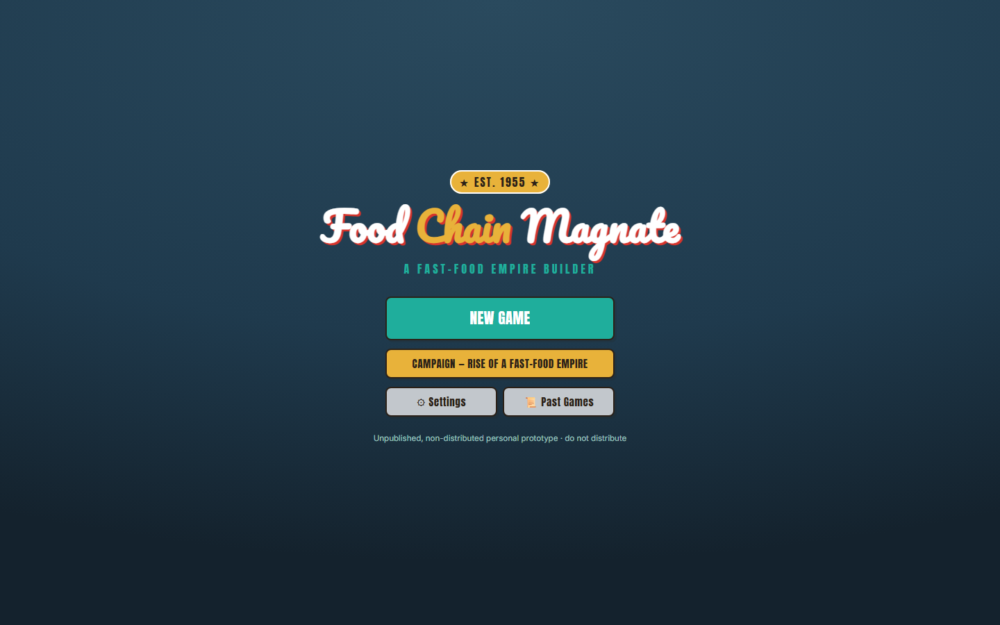

### New-game setup (skirmish lobby) — `NewGameSetup.tsx`
Pick **2–4 seats** (seat 1 is you); each AI rival gets a **personality** dropdown (with its one-line
playstyle "tell") and a **difficulty** (Easy / Medium / Hard). Each company shows its crest and color.
**START** launches the game; the 4-seat cap is a deliberate config-level scope decision (the engine is
player-count-generic).

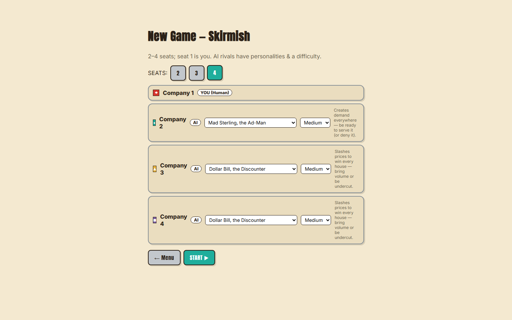

### In-game shell — `GameShell.tsx`
The play surface, a three-column layout under a **bank-clock crown**. Top crown: turn counter, the
**bank-clock gauge** (bank remaining + the two break dots ●○), a replay-Dinnertime button, and Pause.
Left column: **Standings** and the **Milestone board**. Center: the **city board**. Right: your **Org
panel** (cards at work + salary + stock) and the **Log**. Bottom **action bar**: a Recruit dropdown,
Market buttons (🍔/🍕/🍺), the queued-intents chip, and **END TURN**. The human queues high-level
intents; produce/buy auto-resolve through the same orchestrator the AI uses.

*Early turn (just started):*
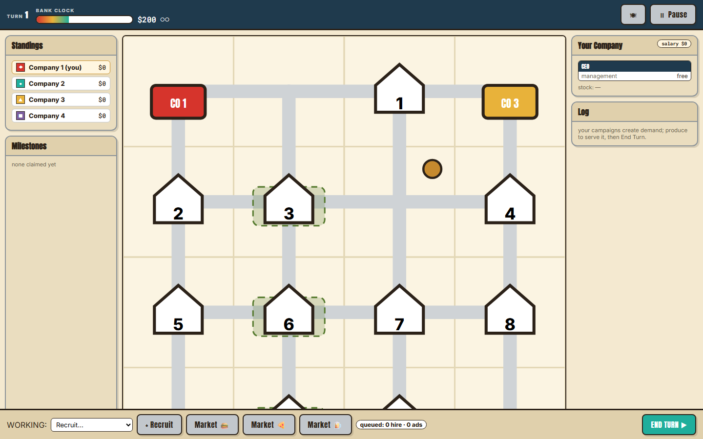

*Mid-game (org filled out, demand on the board, standings + milestones + log populated):*
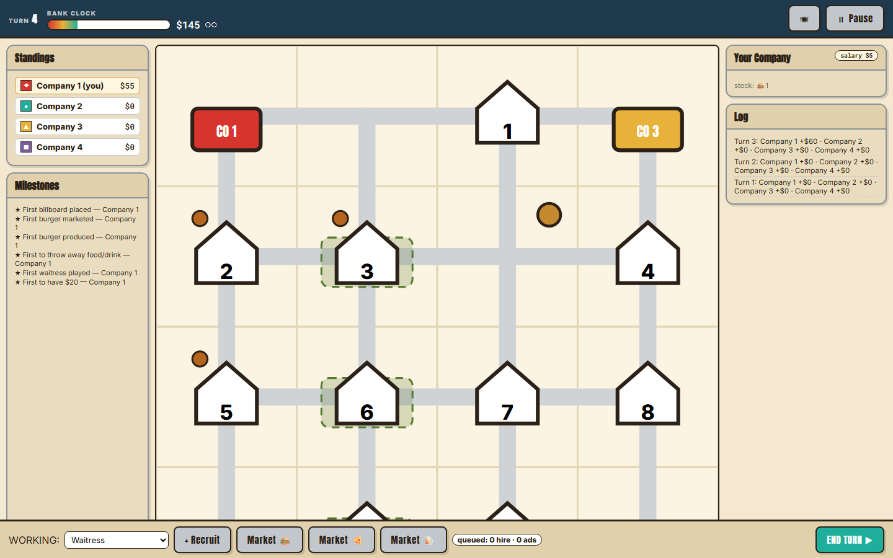

**City board — `Board.tsx`** (the center column above): an SVG of the tile grid and road network, numbered
**houses** (Dinnertime serve order) with garden plots and pending-demand tokens, **drink sources**,
each company's **restaurants** (open + "SOON"), and placed **marketing pieces** — all color-coded by
company and product.

### Dinnertime step-through — `DinnertimeView.tsx`
**The marquee digital-only feature.** After a turn with demand it auto-opens and walks the Dinnertime
resolution **house by house**: what the house wants, the eligible chains with their `price + distance`
math, who **WINS**, who was **disqualified** and why (no road / can't serve the full order), tie-breaks,
and the payout — then an after-houses summary (waitress income + CFO bonus + total earned). Controls:
Prev / Next / Skip-to-end / Replay. Re-openable any time via the 🍽 button.

*A house being resolved (winner by price + distance; rivals disqualified):*
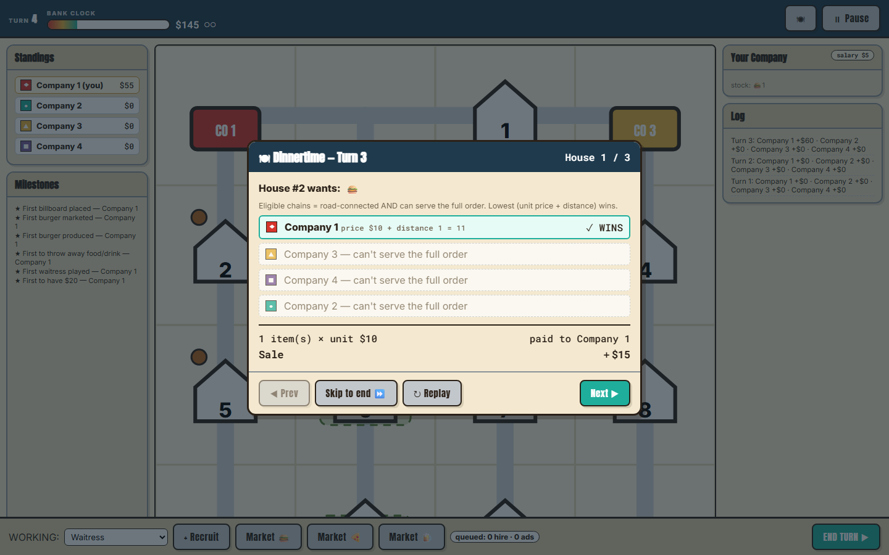

*The next house in the walkthrough:*
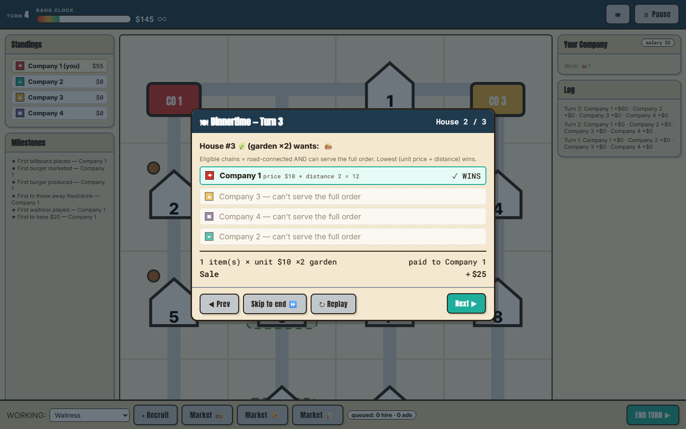

*The after-houses summary (waitress / CFO / total earned, paid from the bank):*
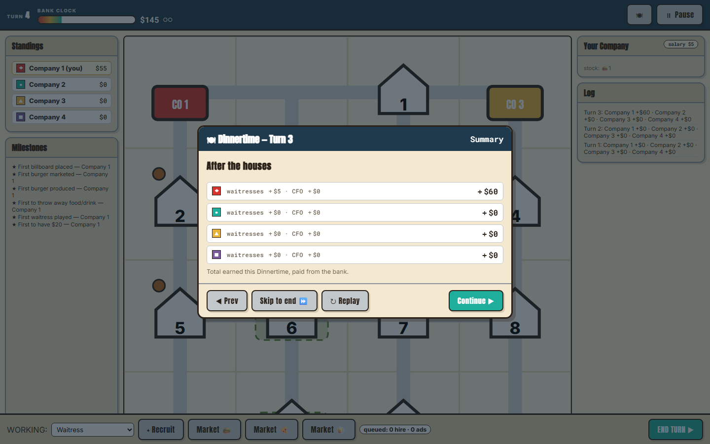

### Settings — `Modals.tsx`
Mute-all toggle, **Music** and **SFX** volume sliders, an **AI-pacing** slider, and **reduced-motion** +
**high-contrast** accessibility toggles. Persisted to `localStorage` and applied live. Reachable from the
main menu and from the in-game pause menu.

*From the main menu:*
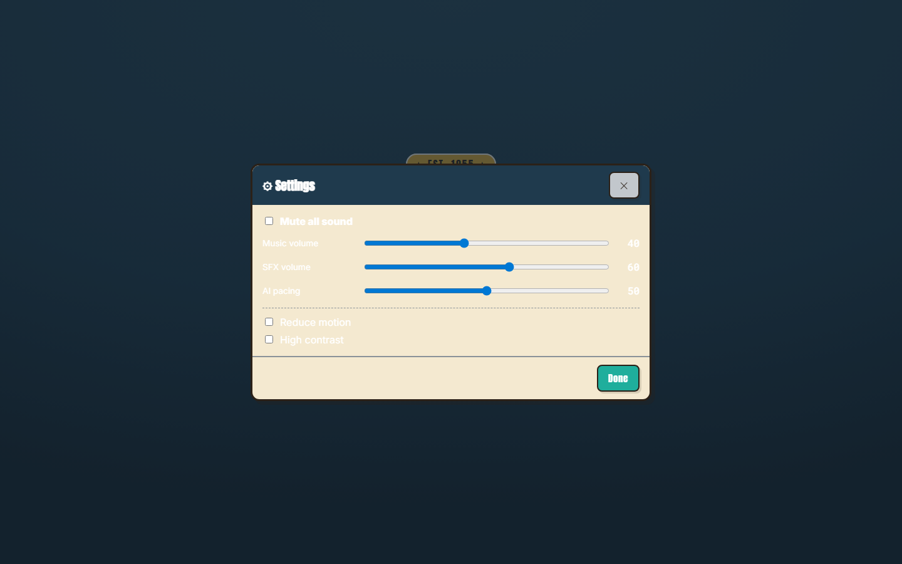

*From the in-game pause menu (same modal):*
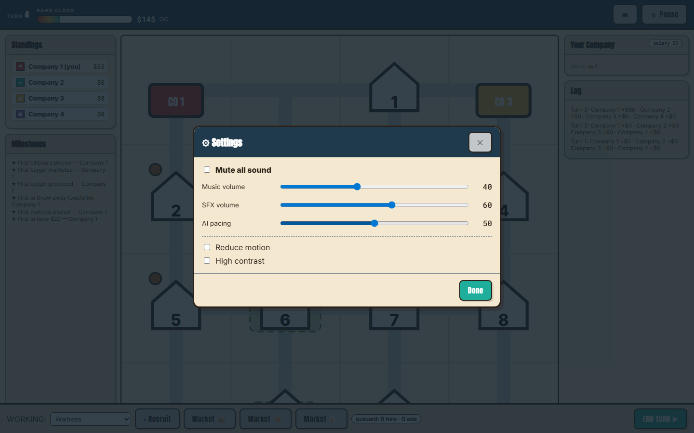

### Past Games (history) — `Modals.tsx`
A list of the last 30 completed games — date, winner, turn count, and the final standings — read from
`localStorage`. (Shown here with representative seeded entries.)

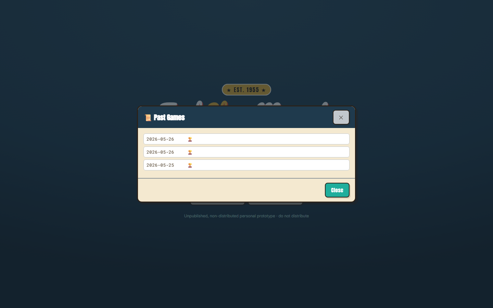

### Pause menu — `Modals.tsx`
Resume, open Settings, or quit to the menu (progress is autosaved, so the menu's Continue can pick it
back up).

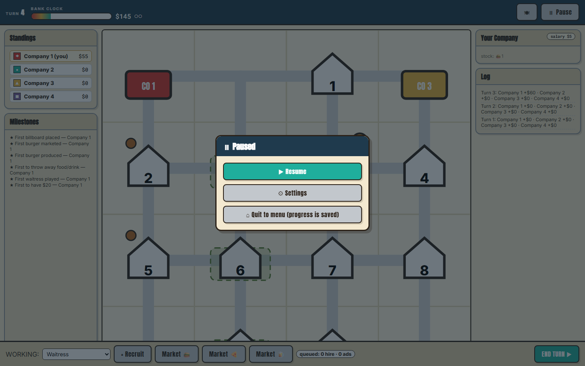

### End screen — `EndScreen.tsx`
Game-over: the winner headline ("You win!" / "{Company} wins"), the final standings with cash, and
New Game / Menu.

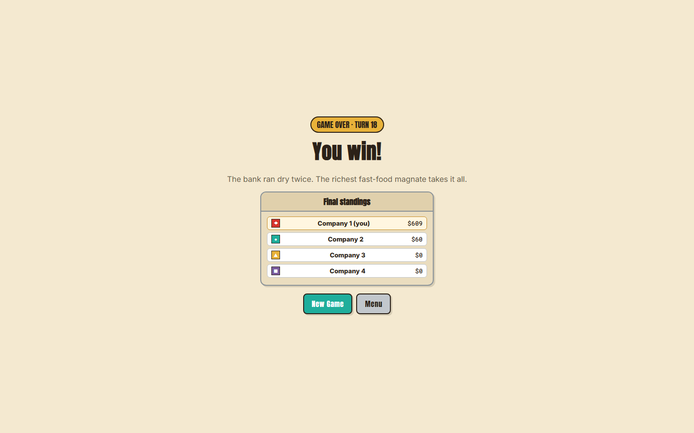

### Campaign hub — `Campaign.tsx`
"Rise of a Fast-Food Empire." A **Career Dossier** (editable company name / color / crest, plus lifetime
stats — cleared count, wins, unlocks) sits above the **arc grouped by era**. Each scenario card shows its
seat/rival count and its state: locked 🔒, cleared ✔, or a medal 🥇🥈🥉. The next scenario unlocks when
the previous one is cleared. (Shown with a representative seeded career: two cleared, the third unlocked.)

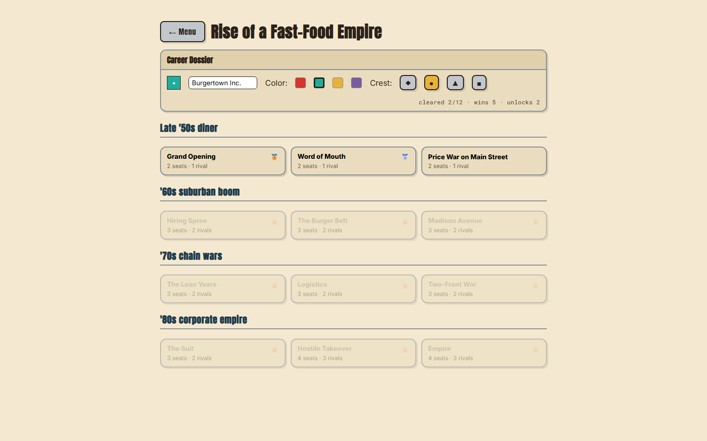

### Campaign briefing — `Campaign.tsx`
A modal before you start a scenario: the briefing flavor and any scenario modifier, the **rival roster**
(named personalities + tier + tell), the **objectives and fail conditions in plain English**, and the
**medal thresholds** (turns-to-win). Start ▶ launches it.

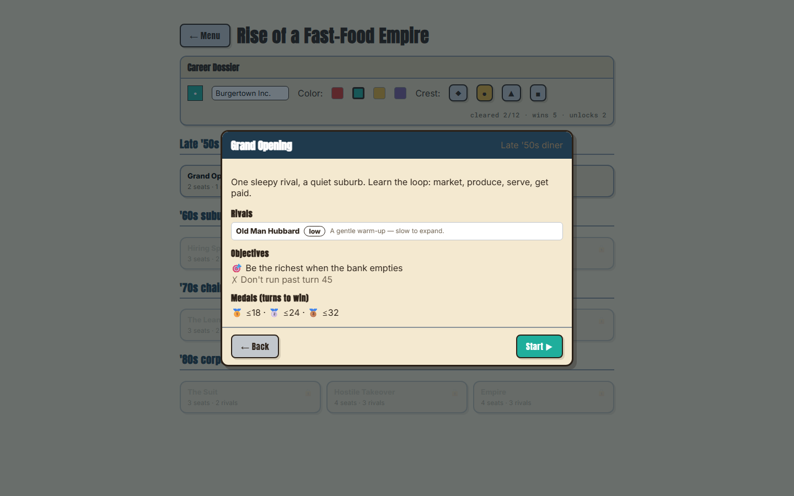

### Campaign in-game (objectives overlay) — `Campaign.tsx` (`ObjectivesPanel`)
The same in-game shell as skirmish, plus a persistent **live objectives panel** in the left column: each
objective ticks ✅/⬜ as it's evaluated every turn, fail conditions are listed, the active scenario
modifier is shown, and the current turn is tracked.

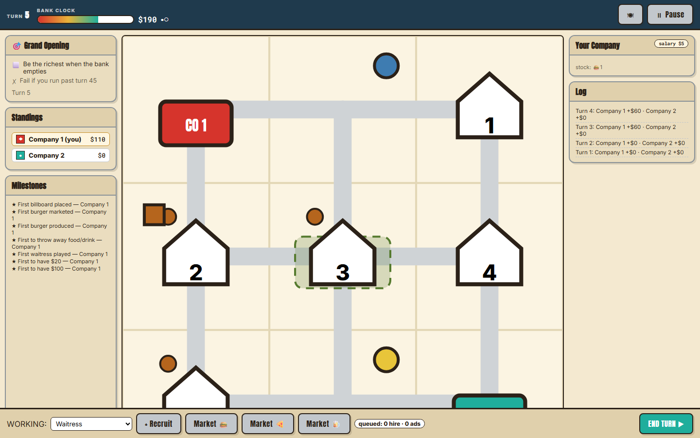

### Campaign debrief — `Campaign.tsx` (`ScenarioDebrief`)
On scenario end: cleared / failed, the **medal earned** (with the "beat it faster" hint if none), any new
**unlocks**, and Campaign-hub / Replay / Menu. The career persists across scenarios.

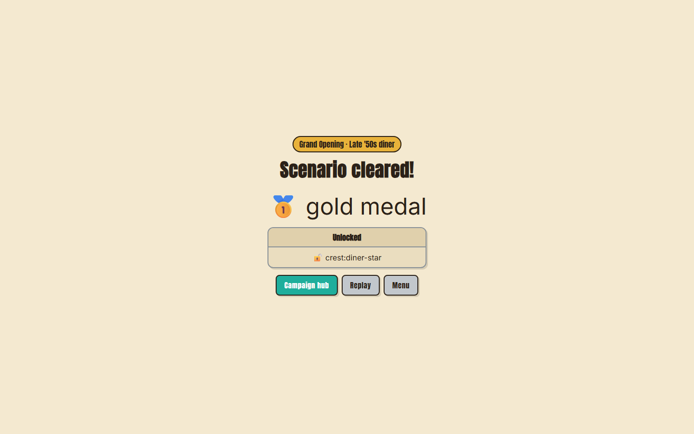

---

## 5. Screenshots — how they were captured

All screenshots in §4 are real captures of the built app, produced by a dedicated Playwright harness,
[`app/tests/e2e/screenshots.spec.ts`](app/tests/e2e/screenshots.spec.ts), at a 1440×900 viewport against
the production `vite preview` build. The harness drives the actual UI — clicking through menus, recruiting
and marketing, stepping the Dinnertime modal, and playing scenarios to their debrief — and writes PNGs to
[`screenshots/`](screenshots/). Re-runnable with:

```
cd app && npm run test:e2e -- screenshots
```

Two states (the **Past Games** list and the **Campaign hub**'s cleared-scenario medals) are seeded via
`localStorage` so those screens render in a realistic, representative state without long playthroughs — the
app itself produces exactly those shapes. The **campaign debrief** screenshot is a genuine live playthrough
(it earned a gold medal on the captured run).

---

## 6. Testing summary

Run from `app/`. All green as of this build.

### Unit + sim — `npm test` (Vitest) → **67 passing** across 12 specs

| Spec | Tests | Covers |
|---|---|---|
| `tests/engine/map.test.ts` | 4 | road graph + BFS chain distance |
| `tests/engine/pricing.test.ts` | 4 | effective unit price across pricing staff + milestone |
| `tests/engine/selling.test.ts` | 9 | Dinnertime resolution, tie-breaks, gardens, the $125 rulebook example |
| `tests/engine/payday.test.ts` | 6 | salary, recruiting-discount rule, effective salary |
| `tests/engine/bank.test.ts` | 4 | the two-break end + winner determination |
| `tests/engine/company.test.ts` | 14 | org-chart legality/capacity, derive, hire/train, working actions |
| `tests/engine/marketing.test.ts` | 6 | campaign footprints + demand generation within caps |
| `tests/engine/milestones.test.ts` | 6 | the 18 milestone triggers + permanent effects |
| `tests/engine/campaign.test.ts` | 4 | every shipped scenario is playable to a definite outcome |
| `tests/engine/simulation.test.ts` | 4 | the M1 scripted sell-loop runner |
| `tests/sim/balance.test.ts` | 3 | full AI-vs-AI games terminate legally + are reproducible; **the difficulty-ladder win-rates** (floors 0.90 / 0.70 / 0.70) |
| `tests/sim/search.test.ts` | 3 | the Hard search runs within its node budget on a mid-game state + is deterministic; on a hand-crafted scenario the depth-2 plan **strictly dominates** the 1-turn (greedy) plan |

### Balance sim — `npm run sim`
The same `balance.test.ts`, reported as a ladder line. Tier-isolated on a neutral profile, 50 seeds per
matchup, alternating seats: **Hard > Low 100% · Hard > Med 76% · Med > Low 82%.** Every game terminates
with a legal winner, >50% end naturally via the 2nd bank break, and runs are reproducible by seed.

### End-to-end — `npm run test:e2e` (Playwright) → **4 passing** (`tests/e2e/play.spec.ts`)
Full skirmish vs AI to the end screen · the Dinnertime step-through shows its reasoning · pause → settings
→ resume · campaign briefing → play a scenario → debrief → hub (career persists). A separate
`screenshots.spec.ts` (3 flows) is the capture harness, not a correctness gate.

### Build + typecheck — `npm run build`
`tsc --noEmit` (strict) clean; `vite build` clean → ~211 kB JS (67 kB gzip) / ~5.9 kB CSS.

---

## 7. Known limitations & deferred items

- **Per-card job-market deck counts are a flagged default.** The real 222-card per-type distribution isn't
  published anywhere fetchable (BGG API / Fandom / Scribd / Wayback / stores all exhausted — it's
  physical-only). The engine uses a generous default (`jobMarketCounts`), so only the rare "the deck ran
  out" rule is affected. Documented in [06-card-reference.md](06-card-reference.md) §9.
- **Interactive campaign scenarios end on the bank break, not on a scenario `turnLimit`.** The `turnLimit`
  fail is evaluated at game end (and enforced headlessly in sims), but the live UI doesn't *stop* the game
  at the limit turn — it plays on until the bank breaks twice, then judges the outcome. A small pre-existing
  gap; flagged, not yet fixed.
- **The Hard search is best-response vs a fixed *Med* opponent model**, not adversarial minimax (by design —
  it's the spec). Against a *Hard* opponent it under-rates them; but the status-quo plan is always a
  candidate, so it never regresses below the old heuristic. Its plan space is **marketing-focused** (product
  × targeting) — widening it (recruiting/training/production variants) is the obvious next lever if a higher
  bar is ever set.
- **Org-chart restructuring is a capacity model, not a drag-drop tree** (legality + open-slot count). The UI
  shows a read-only fielded list; manual tree arrangement is a refinement.
- **Mailbox footprint is approximated at tile level** (tile + orthogonal neighbours); the exact sub-tile
  "block" geometry needs sub-tile roads (also why map tiles are procedural).
- **Marketing range isn't enforced in `placeCampaign`** (the AI/UI self-restrict to sensible tiles) — loose
  for short-range trainees, fine for unlimited-range brand managers.
- **Desktop/mobile wrapping (Tauri/Capacitor) is deferred** — web-first; the codebase stays wrap-ready.

None of these block playtesting the core loop, the difficulty ladder, the campaign, or the front-of-house.

---

## 8. File index

**Stage artifacts**
- [01-candidate-brief.md](01-candidate-brief.md) — discovery brief
- [02-market-analysis.md](02-market-analysis.md) — market / competition / audience / IP analysis
- [03-mvp-spec.md](03-mvp-spec.md) — the MVP product spec (ruleset, screens, modes, UI substrate)
- [04-build-plan.md](04-build-plan.md) — the engineering build plan (milestone ladder)
- [05-game-design-doc.md](05-game-design-doc.md) — the design bible (visual identity, systems, UX)
- [06-card-reference.md](06-card-reference.md) — employee/training/milestone data transcribed from the rulebook
- [build-report.md](build-report.md) — the change-by-change build log (passes 1–4)
- [07-build-overview.md](07-build-overview.md) — **this document**

**Concept art & app**
- [concept/index.html](concept/index.html) — the code-drawn HTML/CSS/SVG concept gallery
- [app/README.md](app/README.md) — the app's own readme (run/test instructions, conventions)
- [app/src/engine/index.ts](app/src/engine/index.ts) — the engine's public API surface
- [app/src/ai/search.ts](app/src/ai/search.ts) — the Hard multi-turn search
- [screenshots/](screenshots/) — the 16 captured PNGs embedded above

**Source rulebook**
- `FCM_Rules_EN_v3.pdf` (+ `.txt` extract) — the operator-supplied official rulebook the data was transcribed from
