# TCG Circuit — Build Report

> Stage 4 (Build) status report. Project **tcg-circuit** ("PRISM"). Updated 2026-05-26 (3-set expansion).
> Stage: **build** · Status: **awaiting-approval** (build gate). Substrate: **DOM + Canvas2D**
> (recorded deviation from `react-ts-pixi` — see `art-direction.md` §12).
>
> Scope built so far: **the card game + the Act I world + the full economy + the life-sim + tournaments
> + the live metagame** — i.e. *everything except the Act II–IV story* (per the user directive). The
> Act II–IV narrative arc is the only intentionally-unbuilt piece.

App lives in `app/`. Run: `npm install` then `npm run dev`. See `app/README.md` for the full dev guide.

---

## 1. What's playable end-to-end

- **Quick Play** (no career): Free Play (any two decks + AI skill), Gauntlet (14-rung ladder), Starter duel, Deckbuilder, Card Gallery.
- **Story Mode** (a saved career): pick a year-level context → walk a top-down world (home / downtown / Pip's Cards / school) → play the 8-beat Act I "Discovery" story (3 story duels) → grow a **collection** via packs + the singles **market** → manage a **day/slot life-sim** (activities, character stats, exams) → enter **shop tournament brackets** for money/fame/prizes → track the **live metagame** (set calendar + B&R) and **community** (forum + deck-tech blog) on your PC.

---

## 2. Component inventory (by layer)

### Engine — `app/src/engine/` (PURE, deterministic; no React/DOM/Pixi)

**PRISM duel — `engine/prism/`**
| File | Responsibility |
|---|---|
| `types.ts` | State/action/card model; constants (Nexus 16, 3 lanes, etc.). |
| `rng.ts` | Seeded mulberry32 (the only randomness — shuffle/draw). |
| `setup.ts` | `createDuel`, `beginTurn`, draw + empty-deck alt-loss. |
| `legalMoves.ts` | The single legal-action source for UI **and** AI. |
| `reduce.ts` | `reduce(duel, action)` — Light/Refract, deploy/cast/attach, 3-lane combat, 8 keywords, win/alt-loss, FX events. |
| `evaluate.ts` | One heuristic shared by the AI ladder + the sim. |
| `index.ts` | Public API. |

**Career sim — `engine/career/`**
| File | Responsibility |
|---|---|
| `types.ts` | `CareerState` (day/slot, money, location, story beat, collection, context, 5 stats, fame, trophies) + actions. |
| `reduce.ts` | Pure `careerReduce`: story beats, sleep (stamina + sponsor stipend), activities, exams, collection (acquire/sell), rewards (money/fame/trophy/flags/unlock). |
| `index.ts` | Public API + `currentObjective`. |

**Content (DATA on registries) — `engine/content/`**
| File | What it holds |
|---|---|
| `cards.ts` / `cards-pr2.ts` / `cards-pr3.ts` | **3 sets, ~132 cards**: First Light (pr1, 60), **Tideturn** (pr2, 37 — Rally/Vengeance), **Deeproots** (pr3, 35 — Momentum). 5 Affinities + neutral, rarity budgets, `faceable` reach. |
| `registry.ts` | Indexes all 3 sets (`ALL_CARDS`); the lookup the engine/AI/UI/sim read. |
| `sets.ts` | The 3 set definitions (themes + new keywords). |
| `format.ts` | Format + Banned/Limited + `isLegalDeck`. |
| `decks.ts` | **14** legal prebuilt archetype decks (10 pr1 + Vanguard/Revenant/Overgrowth/Deep Control) + `expandDeck`. |
| `opponents.ts` | 14-opponent roster (rising skill + personas). |
| `packs.ts` | Booster defs + pure `openPack` (rarity slots, 1 Rare+ guaranteed). |
| `market.ts` | Pure daily-drift singles price model. |
| `lifesim.ts` | Year-level contexts, 5 stats, activities, `examDue`. |
| `story.ts` | Act I "Discovery" script (8 beats, 3 story duels). |
| `world.ts` | 4 locations as tilemaps + NPCs/objects/doors. |
| `tournaments.ts` | Tournament defs (FNM + Shop Cup) — AI brackets. |
| `calendar.ts` | Campaign calendar: set drops + B&R; `currentFormat(day)` shifts legality over time. |
| `community.ts` | Forum threads + deck-tech blog posts. |

**AI / Sim**
| File | Responsibility |
|---|---|
| `ai/ai.ts` | Continuous-skill AI: keyword-aware greedy + 1-ply lookahead below skill 0.8, **determinized MCTS** above; named bands. |
| `ai/mcts.ts` | Determinized UCT (PIMC) — hides hidden info, eval-leaf tree search; beats greedy 91.7% head-to-head. |
| `ai/match.ts` | Headless deterministic match runner (tests + sim; per-side policy override). |
| `sim/balance.ts` | Archetype win-rate matrix + skill-monotonicity ladder. |

### Presentation / UI — `app/src/`
| File / area | Responsibility |
|---|---|
| `render/theme.ts` | Brand tokens (Affinity ramps, rarity, UI palette), pixel fonts, plasma palettes. |
| `render/PlasmaBackground.tsx` | Canvas2D living background. |
| `render/overworld.ts` | Procedural placeholder tile/sprite/object drawing. |
| `assets/manifest.ts` | **Asset seam** — keyed art, `src:null ⇒ procedural`; set `src` + `preloadAssets()` for real art (no code change). |
| `ui/store.ts` | Zustand composition root: engine ↔ UI ↔ beat-paced AI driver ↔ world/career ↔ economy ↔ tournaments ↔ fx ↔ persistence. |
| `ui/CardFace.tsx` | The **one** card model (3 sizes), reused everywhere. |
| `ui/Modal.tsx` `atoms.tsx` `CurveBar.tsx` | Shared shell + atoms (every overlay uses `<Modal>`). |
| `ui/App.tsx` | Router (menu / duel / deckbuilder / gallery / world) + overlays + fly layer + card-peek. |
| `ui/MainMenu.tsx` | Continue / New Story / Quick Play / Gallery / Deck Builder / Rules / Settings. |
| `ui/DuelScreen.tsx` | The PRISM board: lanes, hand, click-to-target, combat, Light gauge, result. |
| `ui/Deckbuilder.tsx` | 30/max-3/curve/**live-format** legality; collection-aware in Story. |
| `ui/Gallery.tsx` | All cards by Set + completion + filters. |
| `ui/Overworld.tsx` | Canvas2D overworld loop: walk, camera, collision, interaction. |
| `ui/world-ui.tsx` | Overworld HUD (day/slot/money/objective/exam badge) + RPG dialogue box. |
| `ui/overlays.tsx` | Every overlay: ModeSelect, FreePlay, Gauntlet, Result, Rules, Settings, Pause, DeskMenu, Shop, Market, PackReveal, ContextSelect, Status, **Tournament**, **PcHub**, **Community**. |
| `ui/FlyLayer.tsx` | Floating damage/heal/Light pops. |
| `audio/sound.ts` | Synth chiptune + SFX (WebAudio, HMR-safe), mixer + mute. |

---

## 3. Systems built (feature view)

| # | System | Status | Notes |
|---|--------|--------|-------|
| 1 | **PRISM card game** | ✅ Done + tuned | Engine, **3 sets / ~132 cards** (First Light + Tideturn + Deeproots), 11 keywords incl. Rally/Vengeance/Momentum, 14-opp skill ladder, 14 prebuilt decks, deckbuilder, gallery, Free Play/Gauntlet/Starter, audio, result gates. Balance sim: spread ~37 pts, ladder monotone. |
| 2 | **Act I world** | ✅ Done | Walkable overworld (4 locations), NPCs + RPG dialogue, 8-beat "Discovery" story (3 story duels vs Milo/Vex/Cora), day/slot loop, bed-save/Continue, Act II hook. |
| 3 | **Collection + packs** | ✅ Done | Owned collection (starts = starter deck); booster packs bought at the shop with a **pack-rip reveal**; collection-aware deckbuilder. |
| 4 | **Singles market** | ✅ Done | PrismSingles.net on the home PC: buy/sell singles, daily-drift prices, trend arrows, wallet. |
| 5 | **Persona life-sim** | ✅ Done | Year-level context select; 5 character stats (Composure/Charisma/Knowledge/Stamina/Reputation); day-slot **activities** (study/work/socialize/practice); **Status** panel; sleep restores Stamina; **exams** (Knowledge check on exam days) + **skip-school** Reputation risk. |
| 6 | **Tournaments + fame** | ✅ Done | Shop tournament **AI brackets** (FNM + a fame-gated Shop Cup) awarding money/fame/prize packs; **fame/scene-reputation** with a **sponsorship perk** (daily stipend at Fame ≥ 10); trophies. |
| 7 | **Live metagame** | ✅ Done | **3-set release calendar** (pr1 day 1, Tideturn day 3, Deeproots day 8) — sets become deck-legal as they drop; **Banned/Limited** dated events; `currentFormat(day)` binds set-legality + B&R in the deckbuilder over the campaign. |
| 8 | **Community** | ✅ Done | PrismNexus diegetic UI on the PC: **News & B&R** feed, **deck-tech forum**, **set-review blog** (with embedded decklists + curve). |
| — | **Act II–IV story** | ⛔ Intentionally not built | The later narrative arc (per directive). The systems above are the engine it would run on. |

---

## 4. Verification (all green)

- `npm run lint` (tsc --noEmit) — clean.
- `npm test` — **45** Vitest engine tests across 6 files (PRISM rules incl. the 3 new keywords, full-duel sim, content/deck legality, career + life-sim, economy, metagame/calendar/community).
- `npm run sim` — across **14 decks / 132 cards** the win-rate spread is compressed (**~37 pts**; Overgrowth ~70% top, Deep Control ~32% bottom — no auto-win/dead deck); skill ladder **sim-verified monotone**; and **determinized MCTS beats the greedy AI 91.7%** head-to-head. (Momentum threats are weighted in the eval so opponents remove growers — the AI-blindness fix.)
- `npm run build` — clean production bundle (~270 KB JS / ~86 KB gzip; Pixi tree-shaken out).
- `npm run test:e2e` — Playwright happy-path (menu/shell, a real-pointer duel turn, Act I world + story-beat advance, economy/life-sim/tournament/community overlays). Screenshots in `app/screenshots/`.

---

## 5. Assets needed (procedural placeholders currently in use)

All world/card art is **code-drawn placeholders** behind `app/src/assets/manifest.ts`. To integrate
real pixel art (LimeZu / thehorseman007 / commissioned), drop files in `app/public/art/`, set each
`src`, call `preloadAssets()` — no code change. Keys: 5 tiles (`tile.*`), 7 character sprites
(`spr.*`, 16×24, 4-dir sheet ideal), 10 objects (`obj.*`), plus per-card `<CardFace>` art.

---

## 6. AI approach & the reinforcement-learning question

**Current AI (what ships).** One continuous `skill ∈ [0,1]` dial with two regimes, both on a shared
**keyword-aware** evaluation, both playing only through the real `legalMoves`/`reduce` (so the AI doubles
as the balance instrument):
- **Below skill 0.8** — greedy + softmax (temperature `f(1−skill)`) + a 1-turn opponent-reply lookahead +
  a decaying blunder floor. Cheap; used by the balance sim and most opponents.
- **At skill ≥ 0.8 (City champ → Worlds)** — **determinized MCTS** (`ai/mcts.ts`); iterations scale with
  skill, so it stays a monotone dial.

**Understanding "minor powers" — the real fix.** A static eval is blind to *time-delayed* value (a 1/1
Momentum unit, a Vengeance death-trigger). Rather than patch the eval per card, `unitValue()` now scores
**every keyword's strategic worth** (Momentum, Vengeance, Guard, Pierce, Drain, Shield, Haste), so the AI
both *plays* and *removes* keyworded threats generically. **Evidence it works:** the Momentum go-tall
deck (Overgrowth) was re-balanced from 79% → **~70%** purely by tuning the Momentum threat-weight in the
eval (opponents now prioritise killing growers) — *no card nerf required*. That's the AI "getting" the
keyword, validated by the sim.

**Deeper play — a false start, then the real path (determinized MCTS, shipped).** First I tried a
**2-turn greedy rollout**; it *regressed* the ladder (skill 0.92 *lost* to 0.6, 37.5%) — a *greedy*
rollout policy is biased, so optimising toward a deeper greedy line is worse than a shallow lookahead.
The fix that works is to **explore + average, not follow one greedy line** → **determinized MCTS**
(`ai/mcts.ts`), now shipped at skill ≥ 0.8:
- **Determinization (PIMC).** Before searching, sample a plausible world — shuffle our own deck (unknown
  draw order) and reshuffle the opponent's hand+deck and re-split (unknown hand) — search several worlds
  and average. This also makes the AI **honest**: the old 1-ply lookahead peeked at the opponent's *real*
  hand; MCTS does not.
- **UCT with eval leaves (no rollout).** To dodge the greedy-rollout bias, leaves are scored by the
  keyword-aware `evaluate()` and the tree (UCB1, minimax across turns) does the lookahead.
- **Result (sim-verified):** at equal skill, MCTS **beats the greedy+eval AI 91.7%** head-to-head
  (wildfire mirror), and the ladder's top rung rose to **90%** (skill 0.92 vs 0.6, was 62.5%). Iterations
  scale with skill (still a monotone dial); it runs in-browser inside the AI's move-beat. The balance sim
  stays at skill 0.6 (greedy), so the tuned spread is unaffected.

**Is reinforcement learning an option?** Yes, and the codebase stays **RL-ready** (pure deterministic
`engine/` = perfect simulator, bounded `legalMoves`, only shuffle/draw randomness, `evaluate()` as a
value-head bootstrap, a Lacuna self-play/Elo precedent). But it's **not needed for this gate**: MCTS
already delivers strong, honest top-end play with no training infra, no tfjs net, and full
determinism/testability. A learned policy/value net (AlphaZero-lite) is the *next* step only to push past
MCTS or to speed it up — the design doc's "top-of-scale stretch." For Act I, the two-regime dial
(keyword-aware greedy below 0.8, determinized MCTS above) is sufficient and sim-verified.

## 7. Known gaps / next

- **3 sets ship** (First Light / Tideturn / Deeproots, ~132 cards) — plenty of pool for Act I. Further
  sets remain data-only (the drop/B&R machinery is proven across all three).
- Final **balance tuning** under human play (the build tunes vs the AI; `/test` does the rest). The AI is
  greedy, so planning-heavy lines (e.g. sequencing Momentum/Vengeance) may read differently in real play.
- **Act II–IV** story (deferred by directive) — the systems above are the engine it runs on.
- Real art via the manifest (above).

---

## 8. Screens — captured UI

Real captures of the built app (DOM + Canvas2D), produced by the Playwright harness
[`app/tests/e2e/playtest.spec.ts`](app/tests/e2e/playtest.spec.ts) at a 1280×800 viewport against the
dev server. The harness drives the actual UI (menus, a real-pointer duel turn, the Act I overworld, and
the economy/life-sim/tournament/community overlays) and writes PNGs to [`app/screenshots/`](app/screenshots/).
Re-runnable with:

```
cd app && npm run test:e2e
```

| Shot | Screen |
|------|--------|
| 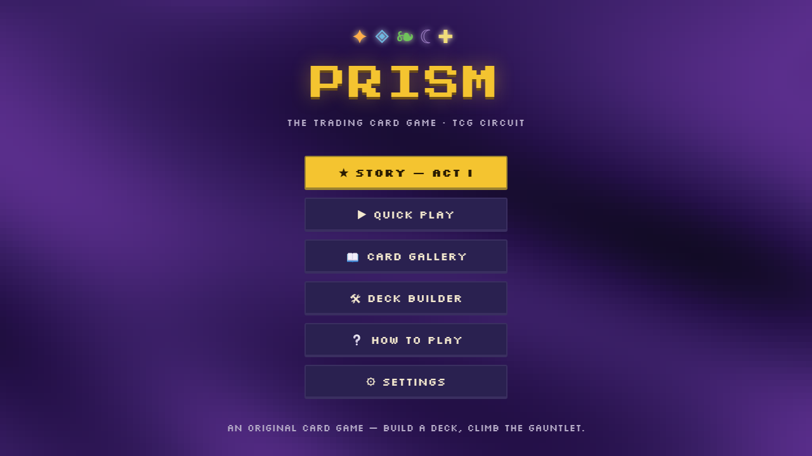 | **Main menu** — the PRISM title + Continue / New Story / Quick Play / Gallery / Deck Builder / Rules / Settings. |
| 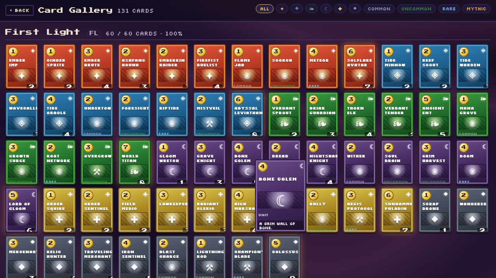 | **Card Gallery** — every card grouped by Set, with completion + filters. |
| 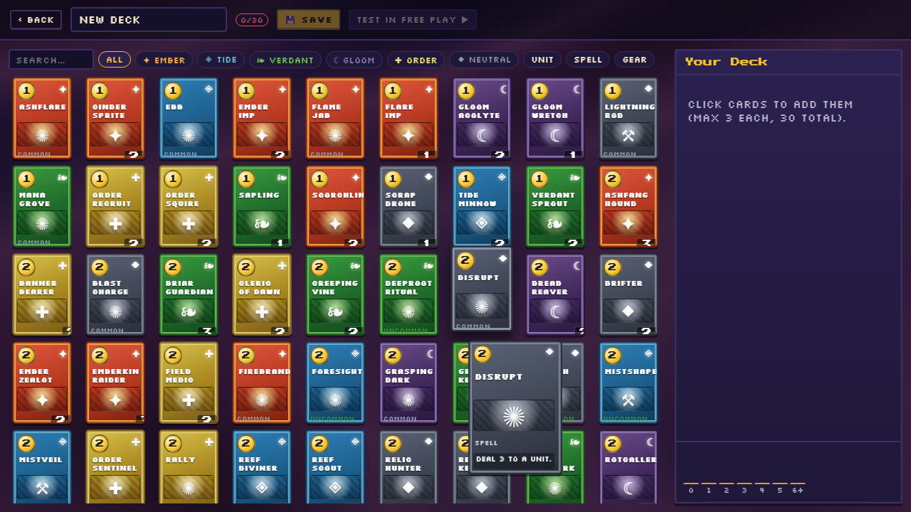 | **Deck Builder** — 30-card / max-3 / curve / live-format legality (collection-aware in Story). |
| 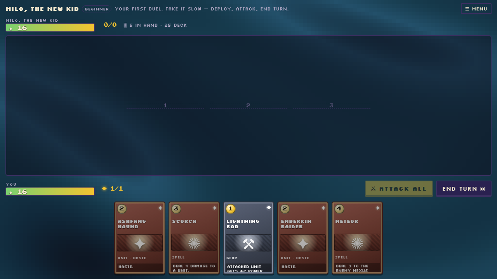 | **PRISM duel** — the 3-lane board, hand, Light gauge, click-to-target combat (vs Milo, the tutorial opponent). |
| 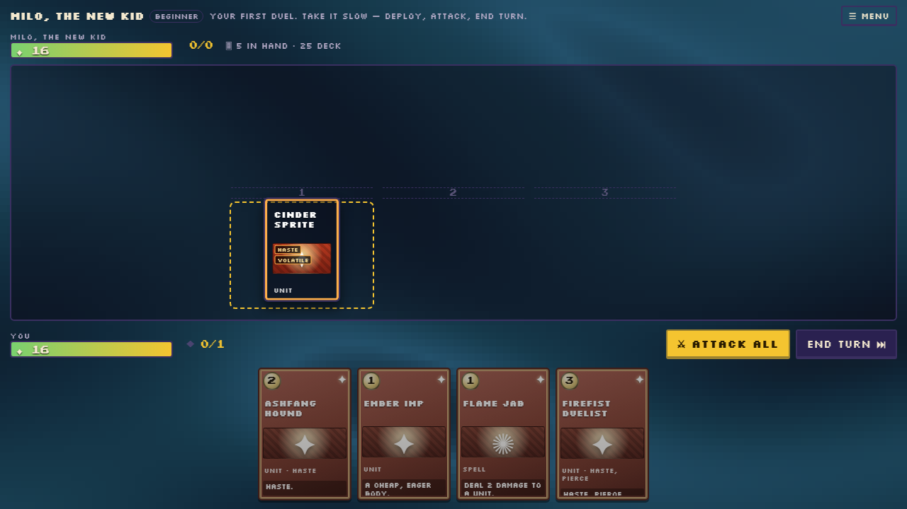 | **Duel — a unit deployed** to a lane (conditional capture; retained from an earlier run when the deploy branch didn't trigger). |
| 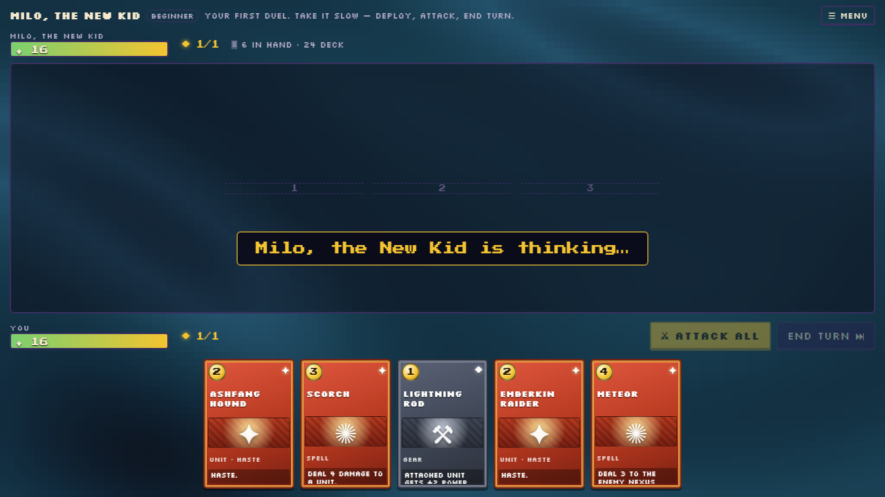 | **Duel — after a full round** (turn advanced, the AI has acted). |
| 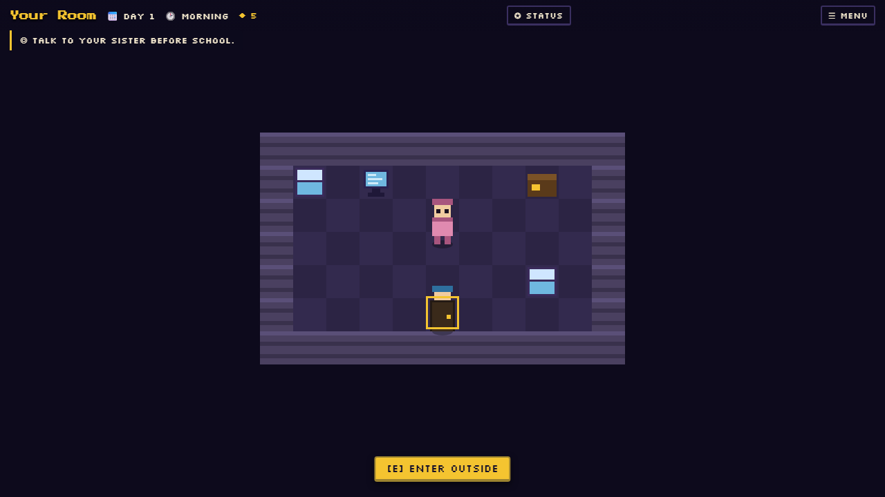 | **Act I overworld — "Your Room"** (top-down JRPG): walk the room, day/slot HUD, objective, "[E] ENTER OUTSIDE". |
| 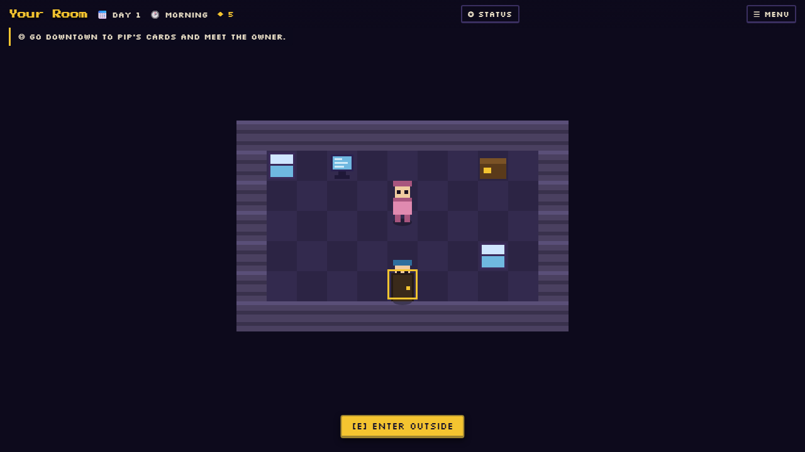 | **Act I overworld** — movement loop outside the room. |
| 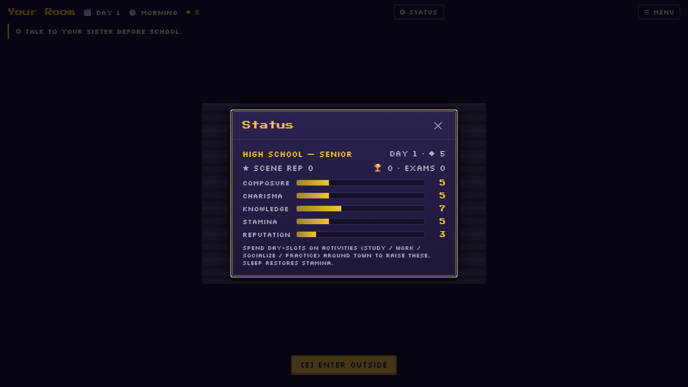 | **Status panel** — the 5 character stats (Composure / Charisma / Knowledge / Stamina / Reputation) + fame. |
| 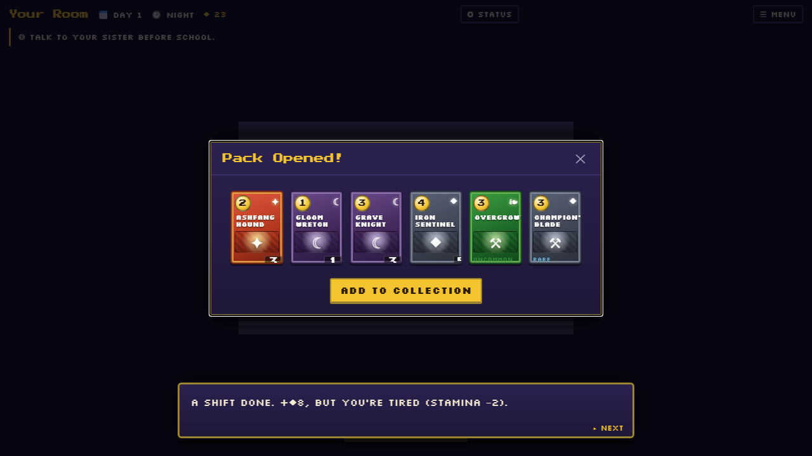 | **Booster pack-rip reveal** — open a pack bought at the shop. |
| 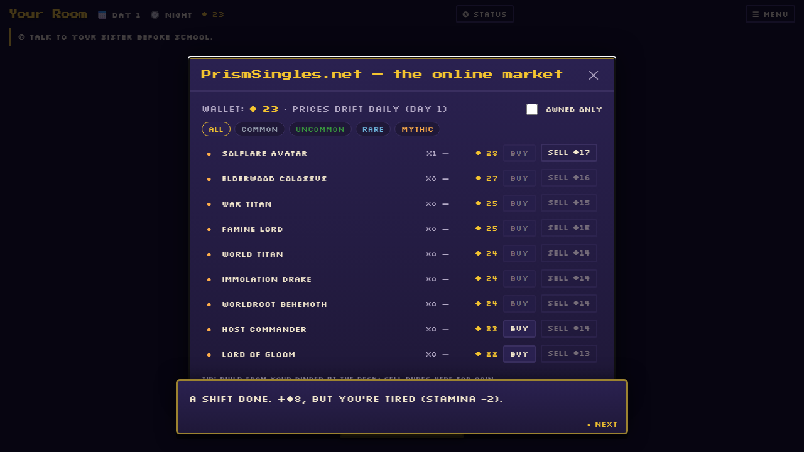 | **PrismSingles.net** — buy/sell singles with daily-drift prices + trend arrows. |
| 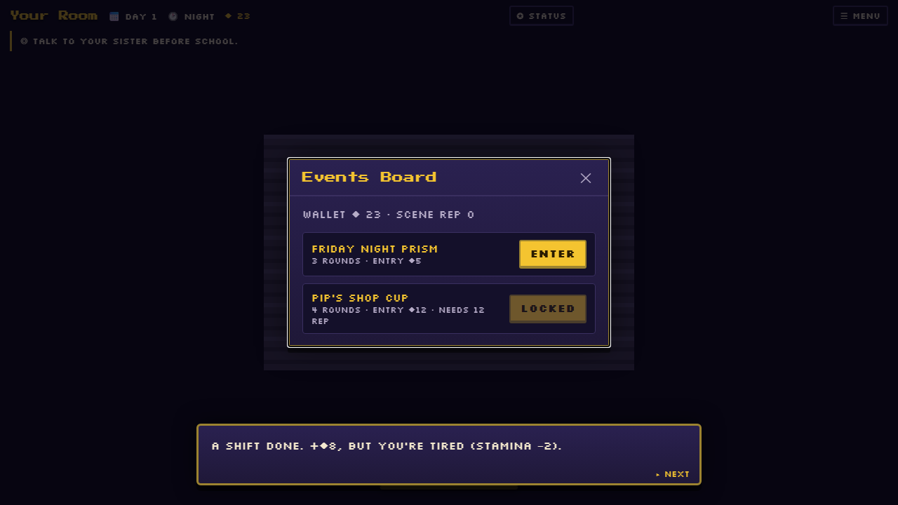 | **Tournament sign-up** — the Friday Night PRISM / Shop Cup brackets. |
| 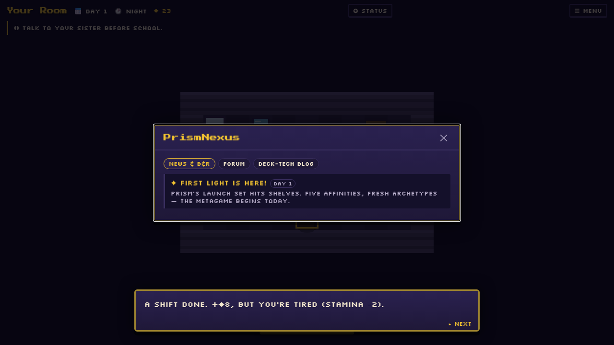 | **PrismNexus** — the community PC: news & B&R, deck-tech forum, set-review blog. |
